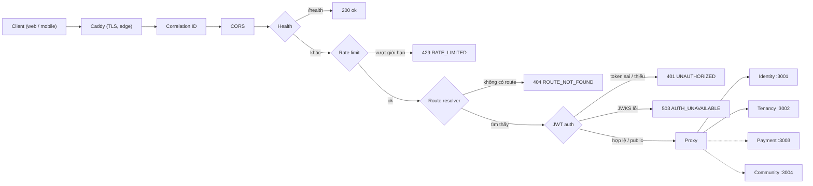

<div align="center">

<h1>Rentify · API Gateway</h1>

<p>Cổng vào duy nhất của hệ thống Rentify: định tuyến theo prefix, xác thực JWT/JWKS, correlation ID, rate limit và CORS.</p>

<p>
  
  
  
  
  
  
  
  <a href="https://github.com/pbl6-home-renter/api-gateway/actions/workflows/deploy.yml"></a>
</p>

<p>
  <a href="#giới-thiệu">Giới thiệu</a> •
  <a href="#bắt-đầu-nhanh">Bắt đầu nhanh</a> •
  <a href="#biến-môi-trường">Biến môi trường</a> •
  <a href="#kiến-trúc">Kiến trúc</a> •
  <a href="#bảng-route">Bảng route</a> •
  <a href="#tài-liệu">Tài liệu</a> •
  <a href="#triển-khai">Triển khai</a> •
  <a href="#đóng-góp">Đóng góp</a>
</p>

</div>

---

## Giới thiệu

`api-gateway` là reverse proxy viết bằng NestJS, đứng ngay sau Caddy trên host **edge** và lắng nghe ở port `3000`. Mọi request từ web (`fe`) và mobile đều đi qua đây trước khi tới các service backend (Identity, Tenancy, và Payment/Community khi được triển khai).

Gateway chỉ lo các mối quan tâm xuyên suốt ở tầng transport: chọn service đích, lọc token ở biên, gắn correlation ID, áp timeout và rate limit, trả lời CORS. **Phân quyền ở mức tài nguyên vẫn thuộc về service sở hữu dữ liệu**, và mỗi service tự verify lại JWT, nên gateway là một lớp lọc chứ không phải nguồn tin cậy cuối cùng.

## Tính năng nổi bật

- **Định tuyến theo prefix dài nhất** — so khớp trọn từng đoạn path (`/api/v1/me` không khớp `/api/v1/members`); `/me/buildings` thắng `/me`. Path được chuyển tiếp **nguyên vẹn**, gateway chỉ chọn host.
- **Xác thực JWT RS256 qua JWKS** — dùng `jose`, kiểm tra `iss`/`aud`, chỉ chấp nhận `RS256`, clock tolerance 5 giây, cache JWKS 5 phút; tự nhận `kid` mới khi Identity xoay key. Token hỏng → `401`; không tải được JWKS → `503 AUTH_UNAVAILABLE` (không làm client bị đăng xuất).
- **Danh sách route public** (`PUBLIC_RULES`) cho đăng ký/đăng nhập, refresh, JWKS, duyệt phòng khi chưa đăng nhập, webhook thanh toán, health/Swagger của từng service.
- **Chống giả mạo header** — xoá mọi `x-user-*`, `x-service-token` do client gửi và các header hop-by-hop (RFC 7230 §6.1) trước khi chuyển tiếp.
- **Correlation ID** — tái sử dụng `x-correlation-id` của client (≤ 128 ký tự) hoặc sinh UUID mới; có mặt trên mọi response, kể cả `401/404/429/503`.
- **Rate limit fixed window** theo IP + nhóm route (`auth` / `refresh` / `api`), trả `429 RATE_LIMITED` kèm `Retry-After`.
- **Stream body không parse** (`bodyParser: false`) — upload multipart hoạt động mà không bị serialize lại.
- **Lỗi upstream rõ ràng** — `503 UPSTREAM_UNAVAILABLE` khi backend từ chối kết nối, `504 UPSTREAM_TIMEOUT` cho các lỗi còn lại.
- **Fail fast** — biến số không hợp lệ (ví dụ `RATE_LIMIT_MAX=12O`) làm gateway từ chối khởi động thay vì chạy sai âm thầm.

## Tech stack

| Thành phần | Công nghệ |
|---|---|
| Runtime | Node.js 24 (`node:24-alpine`) |
| Framework | NestJS 12 trên `@nestjs/platform-express` |
| Ngôn ngữ | TypeScript 6 (strict) |
| Proxy | `http-proxy-middleware` 3 |
| JWT / JWKS | `jose` 6 |
| Đóng gói | Docker multi-stage build, image `linux/amd64` |
| CI/CD | GitHub Actions → Docker Hub → EC2 (SSH) |

## Bắt đầu nhanh

### Yêu cầu

- Node.js **≥ 20.6** (cần cờ `--env-file`; image production dùng Node 24)
- npm
- Identity Service chạy ở `http://localhost:3001` nếu muốn test đăng nhập thật

### Cài đặt

```bash
git clone https://github.com/pbl6-home-renter/api-gateway.git
cd api-gateway
npm install
```

### Cấu hình

```bash
cp .env.example .env          # Windows: copy .env.example .env
```

> [!IMPORTANT]
> App **không tự đọc** file `.env`. Khi chạy bản build, nạp nó bằng `node --env-file=.env`; khi dùng `npm run start:dev`, phải export các biến env trong shell trước.

### Chạy

```bash
npm run build
node --env-file=.env dist/main.js
```

Kiểm tra nhanh:

```bash
curl http://localhost:3000/health
curl -X POST http://localhost:3000/api/v1/auth/login -H 'Content-Type: application/json' \
     -d '{"identifier":"<email hoặc username>","password":"..."}'
curl http://localhost:3000/api/v1/me -H "Authorization: Bearer <accessToken>"
```

`/health` do chính gateway trả lời: `{"status":"ok","service":"api-gateway"}`.

## Biến môi trường

Mọi cấu hình được [`GatewayConfigService`](src/config/gateway-config.service.ts) đọc **một lần** lúc khởi động. Giá trị mẫu lấy từ [`.env.example`](.env.example).

| Biến | Bắt buộc | Mặc định / ví dụ | Mô tả |
|---|---|---|---|
| `PORT` | Không | `3000` | Port lắng nghe |
| `NODE_ENV` | Không | `development` | Môi trường chạy (image Docker đặt `production`) |
| `IDENTITY_SERVICE_URL` | Có* | `http://localhost:3001` | Base URL Identity. Để trống → các route của nó trả `404` |
| `TENANCY_SERVICE_URL` | Có* | `http://localhost:3002` | Base URL Tenancy |
| `PAYMENT_SERVICE_URL` | Không | `http://localhost:3003` | Base URL Payment (chưa triển khai → để trống) |
| `COMMUNITY_SERVICE_URL` | Không | `http://localhost:3004` | Base URL Community (chưa triển khai → để trống) |
| `JWKS_URL` | Có | `http://localhost:3001/api/v1/.well-known/jwks.json` | JWKS của Identity. Để trống → request có token tới route bảo vệ trả `503 AUTH_UNAVAILABLE` |
| `JWT_ISSUER` | Không | `rentify-identity` | Phải trùng `JWT_ISSUER` của Identity |
| `JWT_AUDIENCE` | Không | `rentify-api` | Phải trùng `JWT_AUDIENCE` của Identity |
| `PROXY_TIMEOUT_MS` | Không | `10000` | Timeout khi gọi upstream |
| `RATE_LIMIT_WINDOW_MS` | Không | `60000` | Độ dài cửa sổ rate limit |
| `RATE_LIMIT_MAX` | Không | `120` | Số request / cửa sổ, nhóm `api` |
| `AUTH_RATE_LIMIT_MAX` | Không | `10` | Số request / cửa sổ, path `/api/v1/auth/*` (trừ refresh) |
| `REFRESH_RATE_LIMIT_MAX` | Không | `60` | Số request / cửa sổ, `/api/v1/auth/refresh` |
| `CORS_ORIGINS` | Không | `http://localhost:5173` | Các origin trình duyệt được phép, ngăn cách bằng dấu phẩy |

<sub>\* Gateway vẫn khởi động khi thiếu, nhưng mọi route của service đó trả `404 ROUTE_NOT_FOUND`.</sub>

> [!NOTE]
> Trong Docker, URL service dùng **tên DNS của Compose** (`http://identity:3001`, `http://tenancy:3002`), không dùng IP. Các biến số nguyên phải là số dương, nếu không gateway sẽ crash ngay lúc khởi động với thông báo `Invalid <NAME>`.

> [!WARNING]
> Người dùng chung một NAT (wifi lớp học, ký túc xá) chung một bucket rate limit. Với `AUTH_RATE_LIMIT_MAX=10`, một buổi demo đông người có thể khoá đăng nhập của cả lớp trong một phút — hãy tăng tạm (ví dụ `50`) trong ngày demo.

## Scripts

| Script | Lệnh | Mô tả |
|---|---|---|
| `npm run build` | `nest build` | Biên dịch TypeScript vào `dist/` |
| `npm start` | `node dist/main.js` | Chạy bản build (cần env đã được nạp) |
| `npm run start:dev` | `nest start --watch` | Chạy ở chế độ watch, tự build lại khi sửa code |

## Cấu trúc thư mục

```text
api-gateway/
├── src/
│   ├── main.ts                        # Bootstrap: bodyParser off, trust proxy 1, correlation ID, CORS
│   ├── app.module.ts                  # Khai báo chuỗi 5 middleware theo thứ tự
│   ├── auth/jwt-auth.middleware.ts    # Verify JWT RS256 qua JWKS (jose)
│   ├── common/                        # CorrelationId, RequestPath (dùng originalUrl)
│   ├── config/gateway-config.service.ts  # Đọc + validate env (fail fast)
│   ├── constants/
│   │   ├── route-paths.constants.ts   # ROUTE_PREFIXES, ROUTE_DEFINITIONS, PUBLIC_RULES
│   │   ├── gateway-service.enum.ts    # Enum GatewayService + tên biến env URL
│   │   └── headers.constants.ts       # Header giả mạo, hop-by-hop, correlation ID
│   ├── health/health.middleware.ts    # GET /health
│   ├── rate-limit/rate-limit.middleware.ts
│   ├── routing/                       # RouteTableService + RouteResolverMiddleware
│   └── proxy/proxy.middleware.ts      # http-proxy-middleware, timeout, lỗi upstream
├── docs/                              # 6 trang tài liệu chuyên sâu (tiếng Việt)
├── .github/workflows/deploy.yml       # Build image + deploy lên EC2 (edge)
├── Dockerfile                         # Multi-stage build trên node:24-alpine
└── .env.example
```

## Kiến trúc

### Vòng đời request



Thứ tự middleware được khai báo trong [`app.module.ts`](src/app.module.ts): **Health → RateLimit → RouteResolver → JwtAuth → Proxy**. Correlation ID và CORS được gắn trong [`main.ts`](src/main.ts), chạy trước cả chuỗi này để mọi response ngắn mạch vẫn có trace ID. Rate limit đứng trước JWT để chặn flood trước khi tốn CPU verify chữ ký; route resolver đứng trước auth để path không tồn tại nhận `404` thay vì `401`.

### Header

| Hướng | Xử lý |
|---|---|
| Client → service | Xoá `x-user-*`, `x-service-token` và header hop-by-hop; đặt `x-correlation-id`; đặt `x-user-id` (từ `sub` của token, **chỉ để log**); `X-Forwarded-For` (`xfwd`); `Host` đổi sang host backend (`changeOrigin`). `Authorization` được chuyển tiếp nguyên vẹn để service tự verify. |
| Service → client | Xoá mọi `access-control-*` từ upstream (CORS chỉ do gateway quyết định) và `x-correlation-id` của upstream; gateway expose `x-correlation-id`, `Retry-After` cho trình duyệt. |

CORS dùng `credentials: false` vì token đi trong header `Authorization`, không dùng cookie. `trust proxy` được đặt bằng `1` để lấy IP thật từ `X-Forwarded-For` do Caddy thêm vào — đổi thành `2` nếu thêm một proxy nữa phía trước.

### Bảng route

Tất cả prefix nằm dưới `/api/v1`, nguồn là `ROUTE_PREFIXES` trong [`route-paths.constants.ts`](src/constants/route-paths.constants.ts) (phản chiếu spec trong `api-docs`). Path không có trong bảng — kể cả `internal/*` — trả `404` và không bao giờ tới backend.

| Service | Biến env URL | Prefix |
|---|---|---|
| Identity | `IDENTITY_SERVICE_URL` | `/auth`, `/users`, `/me`, `/media`, `/audit-logs`, `/.well-known`, `/identity` |
| Tenancy | `TENANCY_SERVICE_URL` | `/buildings`, `/admin/buildings`, `/rooms`, `/rate-policies`, `/billing-settings`, `/contract-templates`, `/contracts`, `/contract-members`, `/meter-readings`, `/invoices`, `/roommate-profiles`, `/match-requests`, `/dashboard`, `/administrative-units`, `/me/buildings`, `/me/rooms`, `/me/room-hub`, `/me/favorite-rooms`, `/me/roommate-profile`, `/me/contracts`, `/tenancy` |
| Payment | `PAYMENT_SERVICE_URL` | `/payments`, `/me/payments`, `/payment` |
| Community | `COMMUNITY_SERVICE_URL` | `/conversations`, `/messages`, `/issues`, `/notifications`, `/me/issues`, `/me/notification-preference`, `/community` |

Prefix `/<service>` (`/identity`, `/tenancy`, …) chứa health và Swagger của từng service: `/api/v1/<service>/health` và `/api/v1/<service>/swagger` (JSON tại `/api/v1/<service>/swagger/json`, dùng cho Apidog).

<details>
<summary><strong>Route public (không cần token)</strong></summary>

| Method | Path |
|---|---|
| `*` | `/health` |
| `POST` | `/api/v1/auth/register`, `/api/v1/auth/login`, `/api/v1/auth/refresh`, `/api/v1/auth/password-reset-requests`, `/api/v1/auth/password-resets` |
| `GET` | `/api/v1/.well-known/jwks.json` |
| `GET` | `/api/v1/buildings`, `/api/v1/buildings/*`, `/api/v1/rooms`, `/api/v1/rooms/*` (khách duyệt phòng) |
| `GET` | `/api/v1/administrative-units/provinces`, `/api/v1/administrative-units/provinces/*/wards` |
| `POST` | `/api/v1/payments/webhooks/*` (xác thực bằng chữ ký ở payment-service) |
| `GET` | `/api/v1/<service>/health`, `/api/v1/<service>/swagger/**` |

`*` khớp đúng một đoạn path, `**` ở cuối khớp phần còn lại. Trên route public, token hợp lệ (nếu có) vẫn được verify và chuyển tiếp; token hỏng được coi như ẩn danh.

</details>

<details>
<summary><strong>Rate limit</strong></summary>

| Nhóm | Áp dụng cho | Mặc định / 60 giây |
|---|---|---|
| `auth` | `/api/v1/auth/*` trừ refresh (login, register, password reset) | `10` |
| `refresh` | `/api/v1/auth/refresh` | `60` |
| `api` | Mọi path còn lại | `120` |

Bucket được khoá theo `request.ip` + nhóm, lưu trong bộ nhớ và được dọn định kỳ. Chỉ phù hợp với **một instance** gateway — state không được chia sẻ giữa nhiều replica.

</details>

### Thêm route mới

Tóm tắt (chi tiết và checklist đầy đủ ở [docs/02-routing.md](docs/02-routing.md#thêm-route-mới)):

1. Trong service: `@Controller('<resource>')` dưới global prefix `api/v1`.
2. Trong gateway: thêm `'/<resource>'` vào danh sách của service đó trong `ROUTE_PREFIXES`.
3. Nếu có endpoint gọi được khi chưa đăng nhập: thêm rule vào `PUBLIC_RULES` **và** đánh dấu `@Public()` trong service.
4. Deploy service trước, gateway sau.

> [!IMPORTANT]
> Mỗi tên resource chỉ thuộc **đúng một** service. Khi spec thêm một `/me/<resource>` mới, phải khai báo nó cho đúng service — nếu không request sẽ rơi vào `/me` của Identity và trả `404`.

### Lỗi do gateway trả về

| Status | `code` | Khi nào |
|---|---|---|
| `401` | `UNAUTHORIZED` | Thiếu hoặc sai token trên route cần bảo vệ |
| `404` | `ROUTE_NOT_FOUND` | Không có prefix khớp, hoặc URL service chưa được cấu hình |
| `429` | `RATE_LIMITED` | Vượt giới hạn (kèm `Retry-After`) |
| `503` | `AUTH_UNAVAILABLE` | Không tải được JWKS / thiếu `JWKS_URL` |
| `503` | `UPSTREAM_UNAVAILABLE` | Backend từ chối kết nối (`ECONNREFUSED`) |
| `504` | `UPSTREAM_TIMEOUT` | Timeout, đứt kết nối, lỗi DNS |

Lỗi do chính service trả về (`400/403/500`…) được chuyển nguyên vẹn về client. Gateway **không** retry, **không** biến đổi response và hiện **chưa** proxy WebSocket.

## Tài liệu

Thư mục [`docs/`](docs/) dạy hai thứ cùng lúc: gateway này hoạt động như thế nào, và các kiến thức nền tảng đằng sau nó. Mỗi trang mở đầu bằng khái niệm, sau đó chỉ ra đúng đoạn code hiện thực khái niệm đó.

Thứ tự nên đọc:

| # | Trang | Bạn sẽ học được |
|---|---|---|
| 1 | [Kiến trúc & vòng đời request](docs/01-architecture.md) | API gateway là gì, request đi qua chuỗi middleware ra sao, Module / DI / middleware trong NestJS |
| 2 | [Routing](docs/02-routing.md) | Định tuyến theo prefix, prefix dài nhất thắng, service backend phải đặt path thế nào |
| 3 | [Xác thực (JWT, JWKS)](docs/03-authentication.md) | Cấu trúc JWT, RS256 vs HS256, JWKS và `kid`, issuer/audience, header định danh tin cậy |
| 4 | [Proxy](docs/04-proxying.md) | Reverse proxy, stream vs buffer body, header hop-by-hop, timeout, correlation ID |
| 5 | [Rate limiting](docs/05-rate-limiting.md) | Thuật toán fixed window, IP client khi đứng sau proxy, dọn bộ nhớ, giới hạn |
| 6 | [Cấu hình & triển khai](docs/06-configuration-and-deployment.md) | Biến môi trường và fail fast, Docker multi-stage build, CI/CD lên EC2 |

Nếu chỉ có 5 phút: xem sơ đồ vòng đời request ở trang 1 và checklist "Thêm route mới" ở trang 2.

**Hợp đồng API:** gateway không có Swagger riêng. Đặc tả OpenAPI chuẩn nằm ở repo [`be`](https://github.com/pbl6-home-renter/be) (`api-docs`); Swagger của từng service xem qua gateway tại `/api/v1/<service>/swagger`.

## Triển khai

Workflow [`deploy.yml`](.github/workflows/deploy.yml) chạy khi push lên `main` hoặc chạy tay (`workflow_dispatch`, bỏ tick `deploy_to_ec2` nếu chỉ muốn publish image):

1. **build-and-push** — buildx build image `linux/amd64` (EC2 dòng t3 là x86_64), push `<DOCKERHUB_USERNAME>/api-gateway:latest`, dùng cache GitHub Actions.
2. **deploy** — SSH vào EC2, `git pull` repo `infra`, chạy `DEPLOY_STACK=edge bash ./scripts/deploy.sh api-gateway`: chỉ pull và tạo lại đúng container gateway.

| Secret | Dùng để |
|---|---|
| `DOCKERHUB_USERNAME`, `DOCKERHUB_TOKEN` | Push image |
| `EC2_HOST`, `EC2_SSH_KEY`, `EC2_USER` (tuỳ chọn, mặc định `ubuntu`) | Deploy qua SSH |

Thiếu secret EC2 thì job deploy chỉ ghi một notice và bỏ qua, không báo fail.

Trên host edge, container được khai báo trong `infra/docker-compose.edge.yml`: `env_file: ./env/api-gateway.env` (tạo từ `infra/env/api-gateway.env.example`), `expose: 3000` (chỉ Caddy truy cập qua mạng Docker), healthcheck `wget --spider http://127.0.0.1:3000/health`.

> [!WARNING]
> Port `3000` **không bao giờ** được public ra Internet — chỉ Caddy được gọi tới gateway. Dùng `expose`, không dùng `ports`.

<details>
<summary><strong>Những thay đổi cần deploy phối hợp</strong></summary>

| Thay đổi | Thứ tự deploy |
|---|---|
| Thêm route trong `ROUTE_PREFIXES` | Service trước, gateway sau |
| `JWT_ISSUER` / `JWT_AUDIENCE` | Sửa env của cả gateway và Identity, rồi deploy cả hai |
| Xoay JWT key | Chỉ Identity — gateway tự nhận `kid` mới qua JWKS |
| Thêm biến env mới | Thêm vào `infra/env/api-gateway.env` trên EC2 **trước** khi deploy code đọc biến đó |

</details>

## Đóng góp

- Luồng nhánh: `main` ← `develop` ← `feature/<id>-<slug>` (ngoài ra `fix/`, `hotfix/`, `docs/`, `ci/`). Task ID theo quy ước `pm/phase-N/issues/`, ví dụ `feature/p6-08-route-invoices`.
- **Không bao giờ** push trực tiếp lên `main` hoặc `develop`; mở Pull Request, cần **≥ 1 reviewer**, merge bằng **squash**.
- Commit message bằng tiếng Anh theo [Conventional Commits](https://www.conventionalcommits.org/), ví dụ `feat(gateway): route administrative geography endpoints`, `ci(deploy): deploy gateway to the edge stack`.
- Kiểm tra `npm run build` trước khi mở PR.
- Mọi thay đổi API phải được cập nhật trong `api-docs/src/` và bundle lại — bảng route của gateway phản chiếu spec đó.

## Hệ sinh thái Rentify

| Repo | Vai trò |
|---|---|
| [**`api-gateway`**](https://github.com/pbl6-home-renter/api-gateway) | Reverse proxy: định tuyến theo prefix, xác thực JWT/JWKS, rate limit |
| [`Identity-Service`](https://github.com/pbl6-home-renter/Identity-Service) | Xác thực, người dùng, hồ sơ chủ trọ; phát hành JWT RS256 |
| [`Tenancy-Service`](https://github.com/pbl6-home-renter/Tenancy-Service) | Tòa nhà, phòng, đơn vị hành chính |
| [`boilerplate`](https://github.com/pbl6-home-renter/boilerplate) | Template NestJS mà mọi backend service được fork từ |
| [`be`](https://github.com/pbl6-home-renter/be) | Hợp đồng OpenAPI 3.0 chuẩn (canonical) |
| [`fe`](https://github.com/pbl6-home-renter/fe) | Web cho chủ trọ (React + Vite) |
| [`mobile`](https://github.com/pbl6-home-renter/mobile) | Ứng dụng Android cho người thuê & chủ trọ |
| [`infra`](https://github.com/pbl6-home-renter/infra) | Docker Compose + Caddy cho hai host EC2 |

## Giấy phép

Dự án học thuật thuộc học phần PBL6 — Trường Đại học Bách khoa, Đại học Đà Nẵng. Chưa phát hành theo giấy phép mã nguồn mở.
