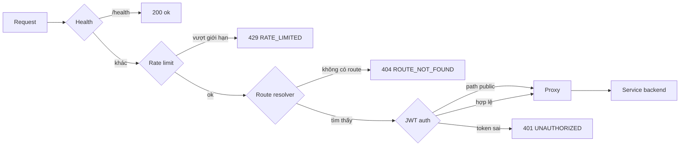

# 1. Kiến trúc & vòng đời request

## API gateway là gì?

Trong hệ thống microservice, service nào cũng cần cùng một bộ "ống nước":
kiểm tra người gọi là ai, chặn spam, truy vết request, xử lý timeout. Nếu mỗi
service tự làm, code bị lặp lại và dễ lệch nhau (service này quên kiểm tra
token hết hạn, service kia trả lỗi theo format khác).

**API gateway** là một service đứng trước tất cả service còn lại và lo hết
phần "ống nước" đó. Client chỉ nói chuyện với gateway; gateway chuyển tiếp
từng request tới đúng backend.

```
                      ┌──────────────────────────── EC2 / mạng Docker ──────────────────────────────┐
Browser / Mobile ──►  │  Caddy :80  ──►  api-gateway :3000  ──►  identity :3001                      │
                      │                                      ├─►  tenancy  :3002   (sắp có)         │
                      │                                      ├─►  payment  :3003   (sắp có)         │
                      │                                      └─►  community :3004  (sắp có)         │
                      └──────────────────────────────────────────────────────────────────────────────┘
```

- **Caddy** là lớp biên: nhận traffic từ Internet. Caddy không biết gì về user
  hay route, chỉ chuyển mọi request API vào gateway.
- **Gateway** quyết định request có được đi tiếp không, và đi tới đâu.
- **Các service backend** chỉ truy cập được bên trong mạng Docker (Compose dùng
  `expose`, không dùng `ports`). Chính điều này làm quyết định của gateway
  đáng tin: không ai đi vòng qua được nó.

### Phân chia trách nhiệm giữa gateway và service

| Việc | Gateway | Service backend |
|---|---|---|
| Token có hợp lệ không? Người gọi là ai? | ✅ | — |
| Service nào sở hữu `/api/v1/rooms`? | ✅ | — |
| IP này gọi quá nhiều chưa? | ✅ | — |
| Role này có được gọi endpoint này không? | — | ✅ (guard đọc `x-user-role`) |
| Phòng 123 có thuộc landlord này không? | — | ✅ (cần dữ liệu) |
| Body request có hợp lệ không? | — | ✅ (validate DTO) |

Nguyên tắc: gateway chỉ lo những việc **không cần dữ liệu nghiệp vụ**.

## Vòng đời của một request

Mỗi request đi qua 5 middleware theo thứ tự (khai báo trong
[app.module.ts](../src/app.module.ts)):



| Bước | Class | Dừng request với | Gắn thêm vào request |
|---|---|---|---|
| 1 | `HealthMiddleware` | `200` cho `/health` | — |
| 2 | `RateLimitMiddleware` | `429` | — |
| 3 | `RouteResolverMiddleware` | `404` | `request.gatewayRoute` |
| 4 | `JwtAuthMiddleware` | `401` / `503` | `request.userClaims` |
| 5 | `ProxyMiddleware` | `503` / `504` khi upstream lỗi | chuyển tiếp tới backend |

**Vì sao thứ tự này quan trọng:**

- Health đứng đầu để healthcheck của Docker không bao giờ bị rate limit hay bị đòi token.
- Rate limit chạy **trước** xác thực JWT. Verify chữ ký tốn CPU; chặn flood
  sớm là để bảo vệ chính gateway.
- Route resolver chạy trước auth để path không tồn tại nhận `404` rõ ràng,
  thay vì `401` khó hiểu.
- Các bước truyền dữ liệu cho nhau bằng cách gắn thuộc tính vào object request
  (`gatewayRoute`, `userClaims`). Bước sau tin tưởng được vì bước trước hoặc đã
  gắn, hoặc đã dừng request.

### Ví dụ đi từng bước

`GET /api/v1/rooms/42` với token hợp lệ của một landlord:

1. Health: path không phải `/health` → `next()`.
2. Rate limit: bucket `203.0.113.7:api` đang 5/120 → tăng lên, `next()`.
3. Route resolver: prefix khớp dài nhất là `/api/v1/rooms` → Tenancy →
   `gatewayRoute = { prefix: '/api/v1/rooms', baseUrl: 'http://tenancy:3002' }`.
4. JWT auth: không phải path public → verify token →
   `userClaims = { sub: 'u_9', role: 'landlord', ... }`.
5. Proxy: chuyển tới `http://tenancy:3002/api/v1/rooms/42` kèm
   `x-user-id: u_9`, `x-user-role: landlord`, `x-correlation-id: <uuid>`, rồi
   stream response về cho client.

## Các khái niệm NestJS được dùng

Gateway không có controller nào: nó không tự xử lý request, chỉ lọc và chuyển
tiếp. Vì vậy nó chỉ dùng những phần của NestJS hợp với việc đó.

### Module và provider

**Module** gom các class liên quan lại. [AppModule](../src/app.module.ts) liệt
kê mọi class trong `providers`, tức là đăng ký chúng vào **DI container**
(container dependency injection) của Nest.

### Dependency injection (DI)

Thay vì tự tạo dependency, class khai báo chúng trong constructor:

```ts
@Injectable()
export class RouteTableService {
  constructor(private readonly config: GatewayConfigService) { ... }
}
```

Nest đọc kiểu của tham số constructor, tìm `GatewayConfigService` đã đăng ký
và truyền vào **đúng một instance dùng chung**. Lợi ích:

- Config chỉ đọc một lần lúc khởi động, dùng chung ở mọi nơi.
- Class không cần biết dependency được tạo ra thế nào, nên dễ test bằng object giả.

`@Injectable()` cùng với `emitDecoratorMetadata: true` trong `tsconfig.json`
là thứ giúp Nest đọc được kiểu tham số constructor lúc runtime.

### Middleware dạng class

Middleware là một hàm `(request, response, next)`: hoặc trả response (kết thúc
request), hoặc gọi `next()` để chuyển cho middleware tiếp theo. Trong Nest,
viết nó thành class implement `NestMiddleware`:

```ts
@Injectable()
export class HealthMiddleware implements NestMiddleware {
  use(request: Request, response: Response, next: NextFunction): void { ... }
}
```

Viết dạng class thì nhận được dependency qua DI và giữ được state (rate
limiter giữ map bucket trong field của nó).

Middleware được gắn trong `AppModule.configure()`:

```ts
consumer
  .apply(HealthMiddleware, RateLimitMiddleware, RouteResolverMiddleware, JwtAuthMiddleware, ProxyMiddleware)
  .forRoutes('*');
```

Thứ tự trong `apply()` **chính là** thứ tự chạy.

### Lifecycle hook

`RateLimitMiddleware` implement `OnModuleDestroy` để dừng timer dọn dẹp khi
app tắt. Nest tự gọi các hook này.

### Bẫy: `request.path` luôn là `/` trong middleware `forRoutes('*')`

Nest gắn middleware wildcard vào một route của Express. Express sau đó cắt
phần đã khớp ra khỏi `request.path` và `request.url`, nên bên trong middleware
của mình chúng chỉ còn là `/`. `request.originalUrl` thì không bao giờ bị sửa, nên:

- [RequestPath.of(request)](../src/common/request-path.ts) đọc path từ `originalUrl`.
- Proxy chuyển tiếp `request.originalUrl` (path + query string).

**Đừng bao giờ dùng `request.path` hay `request.url` trong codebase này.** Nếu
dùng, mọi route đều trông như `/` và gateway trả 404 cho tất cả.

## Các thiết lập lúc bootstrap

[main.ts](../src/main.ts) đặt ba thứ đáng hiểu:

| Thiết lập | Lý do |
|---|---|
| `bodyParser: false` | Gateway không bao giờ đọc body. Giữ nguyên stream gốc giúp chuyển tiếp mọi kiểu nội dung (JSON, upload multipart, binary) nguyên từng byte. Xem [Proxy](04-proxying.md). |
| `app.set('trust proxy', 1)` | Gateway đứng sau đúng một proxy (Caddy). Thiết lập này giúp `request.ip` là IP thật của client lấy từ `X-Forwarded-For`. Xem [Rate limiting](05-rate-limiting.md). |
| `enableCors({ origin: true, credentials: true })` | Chấp nhận mọi `Origin`, để web app chạy được từ bất kỳ host nào khi demo bằng IP. Khi có domain thật thì nên giới hạn lại danh sách origin. |
