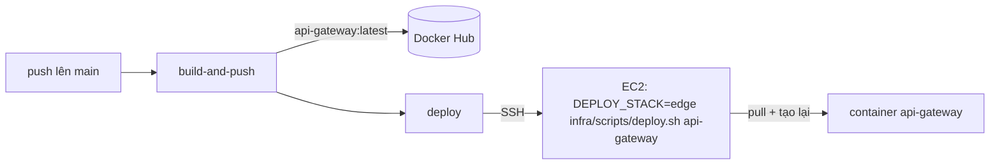

# 6. Cấu hình & triển khai

## Biến môi trường

Mọi cấu hình đến từ biến môi trường, được
[GatewayConfigService](../src/config/gateway-config.service.ts) đọc **một lần** lúc khởi động.

| Biến | Mặc định | Mục đích |
|---|---|---|
| `PORT` | `3000` | Port lắng nghe |
| `IDENTITY_SERVICE_URL` | — | Ví dụ `http://identity:3001`. Không đặt → các route của nó trả 404 |
| `TENANCY_SERVICE_URL` | — | Ví dụ `http://tenancy:3002` |
| `PAYMENT_SERVICE_URL` | — | Ví dụ `http://payment:3003` |
| `COMMUNITY_SERVICE_URL` | — | Ví dụ `http://community:3004` |
| `JWKS_URL` | — | Ví dụ `http://identity:3001/api/v1/.well-known/jwks.json`. Không đặt → request có token tới route cần bảo vệ trả `503 AUTH_UNAVAILABLE` |
| `JWT_ISSUER` | `rentify-identity` | Phải bằng `JWT_ISSUER` của Identity |
| `JWT_AUDIENCE` | `rentify-api` | Phải bằng `JWT_AUDIENCE` của Identity |
| `PROXY_TIMEOUT_MS` | `10000` | Timeout khi gọi upstream |
| `RATE_LIMIT_WINDOW_MS` | `60000` | Độ dài cửa sổ rate limit |
| `RATE_LIMIT_MAX` | `120` | Số request mỗi cửa sổ, nhóm chung |
| `AUTH_RATE_LIMIT_MAX` | `10` | Số request mỗi cửa sổ, path `/api/v1/auth/` (trừ refresh) |
| `REFRESH_RATE_LIMIT_MAX` | `60` | Số request mỗi cửa sổ, `/api/v1/auth/refresh` |
| `CORS_ORIGINS` | `http://localhost:5173` | Danh sách origin trình duyệt được phép, ngăn cách bằng dấu phẩy (vd. `http://<EC2_IP>:5173`) |

URL service dùng **tên DNS của Docker** (`identity`, `tenancy`), tức tên
service trong Compose, chứ không dùng IP. Docker tự phân giải chúng trong mạng chung.

### Fail fast khi cấu hình sai

```ts
private readInt(name: string, fallback: number): number {
  ...
  if (!Number.isFinite(value) || value <= 0) {
    throw new Error(`Invalid ${name}: expected a positive number, got "${raw}"`);
  }
}
```

Một lỗi gõ như `RATE_LIMIT_MAX=12O` (chữ O) nếu không kiểm tra sẽ thành `NaN`,
mà `count >= NaN` luôn là `false`: rate limiter âm thầm tắt hẳn. Ném lỗi lúc
khởi động biến nó thành một lần crash có thông báo rõ ràng, thấy ngay trong
`docker compose logs api-gateway`.

Nguyên tắc chung: **service cấu hình sai thì nên từ chối khởi động, thay vì
chạy với hành vi sai mà không ai nhận ra.**

### Tra URL service có kiểu rõ ràng

URL service được tra theo enum `GatewayService`, không theo chuỗi tự do:

```ts
config.getServiceUrl(GatewayService.Tenancy)
```

Gõ nhầm kiểu `GatewayService.Tenency` là lỗi biên dịch. Gõ nhầm một chuỗi thì
chỉ ra `undefined` lúc chạy.

## Chạy local

```bash
npm install
cp .env.example .env          # Windows: copy .env.example .env
npm run build
node --env-file=.env dist/main.js
```

- App không tự đọc file `.env`. Cờ `--env-file` (Node ≥ 20.6) nạp nó vào.
- Chạy Identity ở local trên `:3001` (global prefix `api/v1`) để test login thật.
- `npm run start:dev` tự build lại khi sửa code, nhưng bạn phải export biến env trong shell trước.

Kiểm tra nhanh:

```bash
curl http://localhost:3000/health
curl -X POST http://localhost:3000/api/v1/auth/login -H 'Content-Type: application/json' \
     -d '{"identifier":"<email hoặc username>","password":"..."}'
curl http://localhost:3000/api/v1/me -H "Authorization: Bearer <accessToken>"
```

## Docker image

[Dockerfile](../Dockerfile) là một **multi-stage build**:

```dockerfile
FROM node:24-alpine AS build        # stage 1: có dev dependency + TypeScript
...
RUN npm run build                   # → /app/dist

FROM node:24-alpine                 # stage 2: image mới, gọn nhẹ
RUN npm install --omit=dev          # chỉ dependency lúc chạy
COPY --from=build /app/dist ./dist  # chỉ chép JS đã biên dịch
CMD ["node", "dist/main.js"]
```

Chỉ stage 2 được đóng gói. Nó không chứa compiler TypeScript, không có
`@nestjs/cli`, không có source code, nên image nhỏ hơn và ít bề mặt tấn công
hơn. `.dockerignore` loại `node_modules`, `.env` và `.git` khỏi build context,
nên secret ở máy local không bao giờ lọt vào layer của image.

Image được build cho `linux/amd64` vì EC2 dòng t3 dùng chip x86_64. Image build
trên laptop ARM (Apple Silicon) mà không có cờ này sẽ lỗi `exec format error` trên EC2.

## CI/CD

[.github/workflows/deploy.yml](../.github/workflows/deploy.yml) có cùng khuôn
với workflow của `fe` và `Identity-Service`:



1. **build-and-push**: buildx build `linux/amd64`, push
   `<DOCKERHUB_USERNAME>/api-gateway:latest`, dùng cache của GitHub Actions để build lại nhanh hơn.
2. **deploy**: SSH vào EC2, `git pull` repo `infra`, chạy
   `DEPLOY_STACK=edge ./scripts/deploy.sh api-gateway`. Khi có tham số, script chỉ pull và tạo
   lại **đúng** container đó (`--no-deps`). Identity, RabbitMQ và web app vẫn chạy bình thường.

Chạy tay: *Actions → Build, Push and Deploy API Gateway → Run workflow*; bỏ
tick `deploy_to_ec2` nếu chỉ muốn publish image.

Các secret cần có trong repo:

| Secret | Dùng để |
|---|---|
| `DOCKERHUB_USERNAME`, `DOCKERHUB_TOKEN` | Push image |
| `EC2_HOST`, `EC2_SSH_KEY`, `EC2_USER` (tuỳ chọn, mặc định `ubuntu`) | Deploy qua SSH |

Thiếu secret EC2 thì job deploy chỉ ghi một notice và bỏ qua, không báo fail.

## Chạy trên EC2

Container được khai báo trong `infra/docker-compose.prod.yml`:

- `env_file: ./env/api-gateway.env`. Tạo file này trên server từ
  `infra/env/api-gateway.env.example`. File đã được git ignore.
- `expose: 3000`: chỉ Caddy truy cập được, qua mạng Docker.
- Healthcheck: `wget --spider http://127.0.0.1:3000/health`.

Các lệnh hay dùng (chạy trong `~/infra`):

```bash
docker compose -f docker-compose.prod.yml logs -f api-gateway    # xem log
docker compose -f docker-compose.prod.yml ps api-gateway         # trạng thái health
DEPLOY_STACK=edge ./scripts/deploy.sh api-gateway                # chỉ deploy lại gateway
```

### Những thay đổi cần deploy phối hợp

| Thay đổi | Thứ tự deploy |
|---|---|
| Thêm route trong `ROUTE_DEFINITIONS` | Service trước, gateway sau |
| `JWT_ISSUER` / `JWT_AUDIENCE` | Sửa cả hai file env, rồi deploy cả hai (`./scripts/deploy.sh` không tham số) |
| Xoay JWT key | Chỉ Identity. Gateway tự nhận `kid` mới qua JWKS |
| Thêm biến env mới | Thêm vào `infra/env/api-gateway.env` trên EC2 **trước** khi deploy code đọc biến đó |
